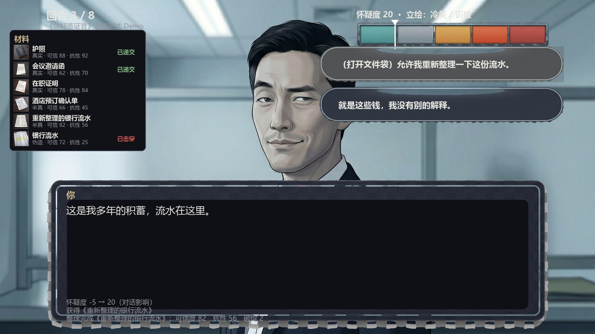
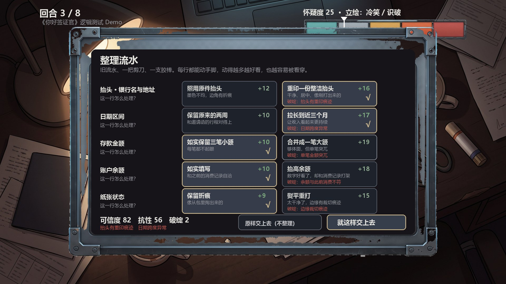
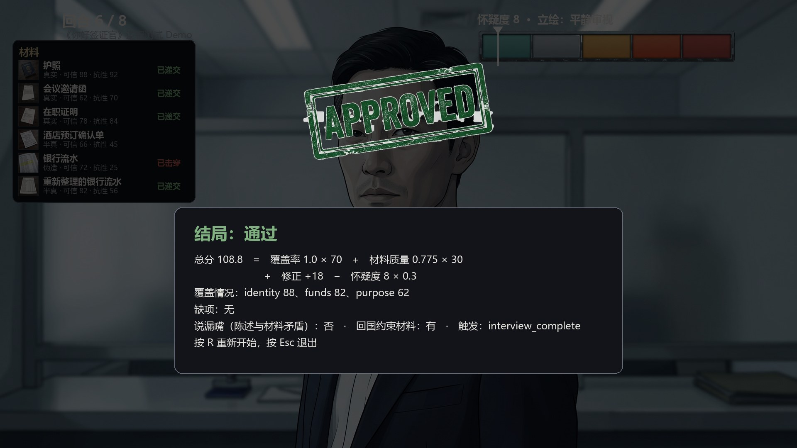

# 你好签证官 · 逻辑测试 Demo

> **Hello, Visa Officer** — a Chinese visual-novel prototype where you bluff your way through a visa interview.
> Data-driven dialogue + a document-forging minigame, running on a UI-agnostic Python engine.
> MIT licensed. Zero-install demo (tkinter + Pillow only).

[](https://github.com/sugering/hello-visa-officer/actions/workflows/tests.yml)
[](LICENSE)
[](https://www.python.org/)

用解谜材料支撑话术，在有限回合内糊弄过签证官。这是一个**可玩的逻辑原型**：
玩法和数值全部跑在引擎里，界面只是渲染层，所以玩一遍就等于跑一遍测试。







## 怎么玩

需要 **Python 3.10+** 与 Pillow（`pip install pillow`）。不需要 Ren'Py、不需要 pygame。

```bash
python demo/app.py          # Windows 也可以双击 run_demo.bat
```

| 操作 | 作用 |
|---|---|
| 鼠标左键 | 推进台词 / 选择话术 / 点格子和单子 |
| 空格 / 回车 | 推进台词 |
| R | 重开一局 |
| S | 截图到 `demo/preview/` |
| Esc | 退出 |

## 玩法

**核心循环**：回合内选择话术或递交材料 → 签证官追问 → 怀疑度与一致性更新 → 触底即出局，回合用尽或谈完则裁决。

三件事构成全部张力：

1. **材料是双轴的**：表面可信度（能骗过第一眼）与抗追问强度（能不能扛住第二眼）。伪造材料两项不可兼得。
2. **说辞要和材料对得上**：你嘴里说的事实会与已递交材料上的事实做比对，矛盾就是 +20 怀疑度加一次全局污点。
3. **失误不是死亡**：材料被追问击穿只是退出评分并加怀疑度，你可以**打开整理台把它重做一遍**。

### 整理流水（文件整理室）

伪造的流水被击穿之后，你在一张旧单子上逐行做取舍：

- 每行**二选一**：照原样留着（分数低、不留破绽），或动手脚（分数高、写进一个破绽）
- 每个破绽扣 12 点抗性 —— 抗性决定它下次被追问时会不会当场崩
- 金额和余额**必须同进同退**，否则额外多一个「总账对不上」

| 打法 | 可信度 | 抗性 | 破绽 |
|---|---|---|---|
| 全保守 | 71 | 80 | 0 |
| 均衡 | 82 | 56 | 2 |
| 全激进 | 92 | 30 | 5 |

分数和"能不能扛住追问"直接对立 —— 这就是这一关真正的选择。

## 测试

```bash
python -m unittest discover -s prototype -p "test_engine.py"   # 19 个：引擎规则
python demo/test_flow.py                                       # 14 个：不开窗口打通关
python demo/test_assets.py                                     #  9 个：素材与配置一致性
```

三套共 **42 个用例**，全程不需要显示器。第二套用**真实点击坐标**驱动状态机，
断言结局、怀疑度、材料状态 —— 改数值或加内容之后跑一遍就知道有没有把路走死。

## 结构

```
prototype/     规则层：引擎 + 谜题 + 内容 JSON + 单元测试（零依赖，可单独取用）
demo/          表现层：session（状态机，无 GUI 依赖）/ layout（纯 Pillow 合成画面）/ app（tkinter 外壳）
assets/        美术素材（已压到 demo 实际需要的分辨率）
tools/         素材工具：棋盘格还原、UI 打包、素材压缩、台本导出
docs/          设计文档：资产清单与预算 / 对话系统 / 材料系统 / Ren'Py 落地
for-gemini/    交给图像生成模型的中英文提示词包（含返工清单）
COLLAB.md      两个 AI 分工协作的协议与实测记录
```

分层是刻意的：`prototype/engine.py` 不认识"立绘"，只输出事件字典；
`demo/session.py` 不认识 tkinter，只做状态转移。换 Ren'Py 只需要替换最外面那层，见 `docs/04`。

## 常见问题

**没有中文字体怎么办？** 界面会打印一次警告并退回 PIL 内置字体（中文变方块）。
Windows 装微软雅黑、macOS 自带苹方、Linux 装 `fonts-noto-cjk` 即可。

**为什么素材有两套？** 仓库里是压缩版（约 7 MB）；全分辨率的生成母版留在开发机上，
被 `.gitignore` 排除了。`tools/pack_assets.py` 与 `tools/pack_ui.py` 是压缩脚本。

**UI 素材上的灰格子是什么？** 图像生成服务用棋盘格表示透明，Gemini导出 JPEG 时棋盘格成了真实像素。
`tools/dechecker.py` 用色键 + 连通域把它抠掉。以后拿到同样的 JPEG 直接跑一遍。

## 授权

代码与素材均按 **MIT** 授权，可自由使用、修改、再分发，详见 [LICENSE](LICENSE)。
素材来源、字体与第三方依赖的说明见 [NOTICE.md](NOTICE.md)：素材是 AI 生成的虚构内容，
不含真实人物与真实机构标识；仓库不包含任何字体文件。

## 状态

玩法结构、美术、核心循环、文档都已完成，是一个**垂直切片**而不是完整游戏：
目前只有一关、7 句台词、两个谜题。下一步是加内容与做发行用的 Ren'Py 版本。

## 贡献者

| 谁 | 做了什么 |
|---|---|
| [@sugering](https://github.com/sugering) | 废物人类，一下午花了几块钱让哦鲸鲸写代码，还顺便花完了GEMINI的5H额度 |
| **DeepSeek（`deepseek-flash`）** | 引擎与玩法实现、无头状态机、tkinter 表现层、三套共 42 个测试、四份设计文档、素材工具链（棋盘格还原 / UI 打包 / 体积压缩）。经由 DeepSeek Harness 会话完成 |
| Google Gemini | 第一轮美术出图：签证官 5 张表情、3 张背景、6 张材料道具、UI 底图 |

